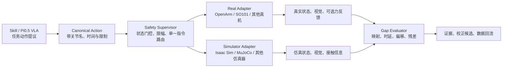

# OpenArm × Isaac Sim Sim2Real 开放接口与集成台账

本文件是 OpenArm 真机、Isaac Sim 仿真、后续 SO101 或其他机械臂/仿真器的统一集成记录。它记录接口约定、发现的问题、已验证的修复和下一次迭代；有效性能数值仍写入 `isaacsim_measurement_log.md`，历史故障细节可追溯到 `README.md`。

## 目标与边界

目标是建立一个可替换真实机械臂和仿真平台的 Sim2Real 基础版本：同一个带名字的动作，分别送入真机适配器和仿真适配器；两端反馈进入同一测量和校正流程。第一版落地对象为 OpenArm 双臂真机 + Isaac Sim，不假设 SO101、MuJoCo 或其他平台已有相同的关节数、话题名或控制器。

系统分为三层：



- **Skill**：抓取、放置、推物等有边界的动作原语。
- **Agent**：根据视觉/语言选择 Skill，并提出有界残差；不直接绕过安全层控制电机。
- **Safety Supervisor**：检查状态新鲜度、动作限幅、急停和操作员确认；它独立于 VLA 与残差模型。

## 开放接口 v0

### 1. Canonical Robot Description

每个适配器必须提供以下能力，而不是要求使用某个 ROS 控制器或某种仿真 API：

| 能力 | 最小接口 | OpenArm + Isaac Sim v0 |
|---|---|---|
| 机器人标识 | `robot_id`、`adapter_version` | `openarm_v2_real`、`openarm_v20_isaac` |
| 关节描述 | `joint_names`、单位、位置/速度/力矩限制 | 通过 real `/joint_states` 与 Isaac articulation DOF 名动态读取 |
| 命名映射 | `canonical_name -> platform_name` | 必须显式保存，禁止以数组下标映射 |
| 动作发送 | 名称化 position/velocity/trajectory target | 真机 forward position controller；Isaac timestamped JointState bridge |
| 状态读取 | 时间戳、name、position，velocity/effort 可选 | 真机 `/joint_states`；仿真 `/sim/openarm/joint_states_v2` |
| 观测读取 | camera/pose/contact/force 的能力声明 | 当前任务相机已采集；力反馈尚未纳入验收 |
| 安全能力 | 限幅、停止、状态新鲜度 | 真机动作必须经操作员批准；health 模式只读 |

动作采用带名字的字典，抽象形式如下：

```yaml
action_id: right_j7_step_001
stamp: {sec: 0, nanosec: 0}
targets:
  openarm_right_joint7: 0.02
limits:
  max_position_error_rad: 0.05
  max_velocity_rad_s: 0.10
  hold_s: 1.0
  return_to_start: true
```

适配器负责将它转换为本平台的数组或消息；比较状态时也先转换回 canonical name。OpenArm 真实双臂当前反馈为 16 名关节（每臂 7 个关节和一个 finger），Isaac articulation 为 18 DOF，因此两者不能直接按数组长度或下标相减。

### 2. 统一运行模式

| 模式 | 是否触发真机动作 | 输出 |
|---|---:|---|
| `health` | 否 | 双端话题可见性、DOF 数、频率与新鲜度 |
| `measure` | 仅操作员批准后 | 原始状态、命令/receipt、误差与时延 |
| `calibrate` | 否，使用已采集数据 | offset、scale、delay、方向相关误差候选 |
| `train` | 否或离线仿真 | 域随机化配置、残差模型和评估结果 |
| `execute_skill` | 仅操作员批准后 | Skill 成功/失败、停机原因和数据回流 |

建议的修正关系是 `u_real = clip(u_sim + Δu, limits)`。先拟合可解释的零位偏移、比例、时延和回程项，再决定是否训练 `Δu`；模型输出不能修改机械限位或绕过安全层。

## OpenArm × Isaac Sim v0 话题契约

| 角色 | Topic | 类型 | 当前状态 |
|---|---|---|---|
| 真机状态 | `/joint_states` | `sensor_msgs/msg/JointState` | 已在真机主机和新主机容器验证可见 |
| 真机左臂命令 | `/left_forward_position_controller/commands` | `std_msgs/msg/Float64MultiArray` | 已验证低幅右 J7 运动；后续应通过统一路由发送 |
| 真机右臂命令 | `/right_forward_position_controller/commands` | `std_msgs/msg/Float64MultiArray` | 同上 |
| 仿真命令 | `/sim/openarm/timestamped_joint_command` | `sensor_msgs/msg/JointState` | 已有 Isaac Script Editor bridge 验证 |
| 仿真 receipt | `/sim/openarm/command_receipt` | 当前 bridge 定义的 receipt 消息 | 已有历史有效记录 |
| 仿真状态 | `/sim/openarm/joint_states_v2` | `sensor_msgs/msg/JointState` | 当前待重新启动唯一 state publisher 后验证 |
| 连通性探针 | `/cross_host_probe` | `std_msgs/msg/String` | 新主机容器 → 真机旧主机已验证 |

当前主机分工：

- **真机旧主机** `tangyuan-System-Product-Name`（`192.168.18.154`）：ROS Jazzy、CAN、OpenArm 真实 bringup。
- **Isaac 新主机** `tangyuan`（`192.168.18.72`）：Isaac Sim；其 `openarm-sim-ros` 容器承载 ROS Jazzy。
- 全部参与 shell 采用同一 `ROS_DOMAIN_ID=42`、`rmw_fastrtps_cpp`，且允许局域网发现。

## 问题、定位、解决与迭代记录

| ID | 现象/问题 | 事实定位 | 已执行的解决或结论 | 状态与下一步 |
|---|---|---|---|---|
| I-001 | 已保存场景难以重新打开、模型似乎丢失 | 场景文件实际为 `alignment/isaacsim_assets/openarm_v20_measurement.usda` | 固定使用该 USDA 场景；后续每次修改后保存到同一路径或版本化副本 | 已解决；每次开机先打开此场景 |
| I-002 | Isaac Script Editor 出现 `IndentationError` | 粘贴脚本时发生缩进错误 | 使用仓库中完整脚本，不分段手工拼接 | 已解决 |
| I-003 | ROS 图出现两个同名 timestamped bridge | Script Editor 重复执行创建了重复 callback/node | 每次重启 Isaac 后只运行一份 bridge；测量前检查每条 command route 仅一个有效发布/订阅路径 | 已解决为流程约束 |
| I-004 | 新主机系统没有 `/opt/ros/jazzy` | ROS Jazzy 安装在 Isaac 新主机的 Docker 容器，而非宿主系统 | Isaac 侧 ROS 指令在 `openarm-sim-ros` 容器执行；不要在新主机宿主机 `source /opt/ros/jazzy/setup.bash` | 已解决 |
| I-005 | 真机和 Isaac 位于两台机器，是否能统一控制 | 真机在 `.154`，Isaac/ROS 容器在 `.72` | 同 ROS domain + DDS 后可由统一 router 分发 canonical action；先完成 state 双向验证 | 架构已确定；router active 试验尚未开始 |
| I-006 | 真机启动后 motor 红灯、无保持力 | 初期急停处于触发状态，后续电机全部绿灯、可回零 | 物理急停释放与真机 bringup 后，右 J7 `+0.02 rad` 已正常执行并回零 | 已验证；真机动作前仍检查急停、工作区和单一命令源 |
| I-007 | CAN `discover` 结果反复缺电机 | `discover` 会重配 CAN 波特率并以 PARAM 回调查询；运行控制链使用具体电机类型和 STATE 回调 | `discover` 的部分/空结果不是运行时链路故障证据，不能在真机控制或测量中反复执行 | 已纠正；以连续 state 和受限动作反馈为准 |
| I-008 | 担心其他进程同时给机械臂发指令导致抖动 | 四个 forward controller topic 的 publisher count 为 0，仅各自 controller subscriber；只见一个真实 bringup | 运行统一试验前保持一个 bringup 与一个命令路由；执行前再次检查 topic publisher count | 当前无冲突证据 |
| I-009 | 新容器 → 旧主机能收到 probe，但 Isaac state 曾不可见 | 历史上新容器内未发现 `/sim/openarm/joint_states_v2`；本轮只读 health 已实际接收该 topic | Isaac state publisher 已恢复；旧主机 ROS 图有唯一 `openarm_isaac_joint_state_publisher`，health 收到 18 DOF | 已解决；继续以 health JSON 复核每次会话 |
| I-010 | Isaac state publisher 曾因二维 position 数组无 state 输出 | Isaac `get_joint_positions()` 返回 `(1,18)`，直接逐项 `float` 会失败 | 使用 `np.asarray(...).reshape(-1)` 压平 position 和 velocity | 已修复在 state publisher 脚本 |
| I-011 | 旧 `/sim/openarm/joint_states` 混入多个 publisher | 有已知与匿名旧 publisher，导致 state 混流 | 隔离为 `/sim/openarm/joint_states_v2`；新试验与分析明确使用 v2 | 已解决为话题隔离约束 |
| I-012 | 手工跨两台机器检查链路繁琐 | 每次需要检查 real state、sim state、DOF、频率和状态新鲜度 | 新增 `alignment/real_sim_gap_agent.py`，一次只读 health 检查并生成 JSON 证据 | 已验证；health 现区分 state 与 command-route readiness |
| I-013 | health agent 在真机主机不能 import `rclpy` | Conda 的 Python 3.13 覆盖 `python3`，但 ROS Jazzy `rclpy` 为 Python 3.12 扩展 | 脚本 shebang 改为 `/usr/bin/python3`；运行方式固定为 `/usr/bin/python3 alignment/real_sim_gap_agent.py` | 已解决；health agent 已以 ROS Python 成功运行 |
| I-014 | 真实 16 关节与 Isaac 18 DOF 没有可机读映射 | real state 仅有每臂一个 finger；Isaac 每臂有两个 finger DOF | 新增 `openarm_isaacsim_joint_map.json`；health agent 验证 16 个 canonical joint，无缺失/重复；两个第二 finger DOF 明确排除 | 已解决为 v0 comparison mapping；新硬件/仿真器需单独 profile |
| I-015 | 双端状态可见但 command route 曾缺失 | 历史 health 未发现 Isaac command/receipt endpoint；后续 health 已报告 `OPENARM_GAP_STATE=READY` 与 `OPENARM_GAP_MEASUREMENT=READY` | 运行唯一 timestamped command bridge，并通过 daemon status 与 health 复核 | 已解决；command route 可见，但不代表 position tracking 已通过 |
| I-016 | Isaac bridge 依赖手工粘贴 Script Editor，Agent 无法自行恢复模块 | 外部 ROS Agent 不能直接操作已有 Script Editor 临时脚本 | 新增 `isaacsim_gap_control_daemon.py`；启动一次后暴露 `ensure_state`、`ensure_bridge`、`ensure_all`、`status` ROS 服务，Agent 可调用服务并以 health 复测 | 已 live 验证：`status` 返回 `state=True bridge=True pending=0 errors=none` |
| I-017 | 原统一 router 的真机路径只有 `enable_real` 开关 | 原实现缺少每次试验授权、反馈新鲜度、单步幅度、机械限位与重复 publisher 门控 | 强化 `dual_target_command_router.py`：要求 `real_authorization_id`，默认 `0.03 rad` 单步限幅、`0.25 s` state 新鲜度、读取 `mechanical_limits.csv`，拒绝未知关节和多个 command publisher | 已静态验证；未启动 router，待操作员批准低幅试验后进行 active 验证 |
| I-018 | sim-only 统一命令 receipt 成功但 Isaac J7 反馈未跟踪目标 | 首次 `+0.02 rad` 后 J7 约 `-0.0749 rad`，回零后约 `-0.0803 rad`；daemon `ensure_bridge` 重载并停止 known static hold 后，复测目标误差仍约 `-0.0907 rad`、回零误差约 `-0.0799 rad`，两条 receipt 均为 `real_sent=false` | 新增 `measure_sim_only_router_tracking.py` 固化“目标、反馈、回零、receipt 必须均通过”的自动测试；known static-hold 覆盖已排除为唯一原因 | 阻塞真机双端 gap 测量；检查 Isaac articulation actuator gain、drive target/position-action 语义、关节限位或其他匿名 controller callback |
| I-019 | Agent 只能恢复 state/bridge，无法以证据定位 I-018 的 live drive 配置 | daemon 原有服务仅加载模块；receipt 不包含 USD drive target、刚度、阻尼、力上限或 bridge active target | 新增只读 `isaacsim_inspect_joint_drive.py`，并为 daemon 增加 `/openarm/isaac_gap/diagnose` 与 `/openarm/isaac_gap/events`；诊断输出 JSON，事件 topic 将 Isaac 内部加载/错误摘要返回终端。Skill 规定先诊断，再提出仅仿真的候选修复并自动复测 | 代码已静态验证；需在 Script Editor 重新运行 daemon 以注册新服务，随后调用 diagnose 验收。I-018 仍阻塞真机双端测量 |
| I-020 | Agent 需要知道各主机启动方式，同时不得自行触发真机上电/回零 | `start_real_openarm.sh` 明确会 enable motor 并可能 return-to-zero；Isaac 与 sim-only router 不会触发真机 | Skill 启动 profile 区分 Isaac 自动恢复、sim-only 自动测试、真机带授权启动与带 trial ID 的 real router | 已写入 Skill 启动规则；真实启动和 real route 保持操作员逐次授权 |
| I-021 | 新增终端诊断事件输出后 Isaac daemon callback 报 `IEvent object is not callable` | `on_update(_event)` 的 Kit event 参数遮蔽了模块级 `_event(message)` 发布函数；加载子脚本后调用 `_event(message)` 实际调用了 Kit event 对象 | 将回调形参改为 `_kit_event`；重新运行 daemon 时会销毁旧 subscription 并恢复 state/bridge/diagnostic 事件流 | 已修复并通过 Python 语法检查；待 Isaac Script Editor live 复验 |
| I-022 | 新 daemon 在旧主机可调用但 status 显示 `state=False bridge=True` | Isaac Script Editor 已运行新 daemon，但它从新主机 `.72` 的 `/home/tangyuan/openarm_ws/alignment/` 读取到旧 state publisher；日志为 `OPENARM_ACTUAL_STATE_ARMED topic=/sim/openarm/joint_states`，与 v2 脚本的 builtins key/topic 不一致 | 同步 state publisher、bridge、drive probe 到 Isaac 新主机，再重新运行 daemon；以 `state=True bridge=True` 和 v2 topic 验收 | 已定位；同步前阻塞诊断和 gap 测量 |
| I-023 | J7 command receipt 成功但仿真不跟踪 | drive probe 显示 `/openarm_v20/Physics/openarm_right_joint7` 为 `force`，但 target/stiffness/damping 均为 `0`；零 stiffness 不构成 position drive | 新增可回滚的 Isaac-only J7 repair：保存原 drive，按当前姿态设 target，设置 stiffness `100`、damping `10`，不改变 max force `7`，随后重载 bridge 并执行 sim-only tracking probe | 已解决：`+0.02 rad` 后误差 `−6.044e−05 rad`，回零误差 `2.241e−05 rad`，2/2 receipt 为 sim-only；证据 `results/sim_only_router_after_j7_drive_repair.json`。真机双端测量仍需逐次授权 |
| I-024 | J7 repair 后首次 sim-only tracking 仍失败 | 输出 `receipt_count=0`、`all_receipts_sim_only=false`，因此 `/openarm/command` 没有经 router 到达 Isaac；该次位置样本不能检验 drive repair | 新增 `start_sim_only_router.sh`，在 source ROS 后才启用 Bash `nounset`，固定 `enable_real:=false` 并拒绝重复 router；先确认 receipt 再重跑 tracking | 已定位为无效试次；不更新有效测量值，真机未发送任何指令 |
| I-025 | 获授权的 real+sim 右 J7 `+0.02 rad` 试验中，仿真达标而真机未跟踪 | router 两次均为 `accepted=true, reason=sim_and_real_sent`；Isaac receipt 两条均收到。target 段真机 `0.0040054932 rad`、仿真 `0.0199379269 rad`，相对目标误差为 `−0.0159945068 / −0.0000620731 rad`，真机-仿真偏移 `−0.0159324337 rad`。真实 controller、hardware component 和 J7 position command interface 都是 active/claimed；试验后已停止 real router。 | 修正 `measure_real_sim_j7_trial.py` 的分析窗口，避免 return 指令后的样本覆盖 target 段结果；记录已验证的 receipt/状态证据。源码审计表明 v2.0 Xacro 正确传入 J7 `kp=10,kd=0.5`，但 hardware plugin 仍是标为 V10 的固定 7 电机实现，且未使用 `arm_type` 选择电机配置。 | 未解决。V10 硬编码是兼容性风险，尚非已证实根因；先以只读方式检查电机型号、CAN ID、MIT mode、目标保持和 feedback 更新。不得从该单一样本自动学习/应用真机残差；后续动作须新建 manifest 并重新逐次授权。 |
| I-026 | 相对 J7 试验在命令前报告 `missing real or sim state before command` | recorder 仅等待 `1 s` 即检查订阅样本；该次进程在 publish 前抛出异常，real router 随即停止，未产生 router receipt 或真实动作。单独 ROS preflight 在此前已可读到两端 state。 | recorder 增加默认 `3 s` 的 `--preflight-s` 和 `--preflight-only` 无动作检查；其后无动作检查收到 real/sim J7 `147/79` 条。 | 已解决为 recorder discovery gate；该次不计入真实试验样本。 |
| I-027 | 相对 `+0.01 rad` 的第二条获授权 J7 试验仍仅仿真跟踪 | 3 s 无动作 preflight 收到 real/sim J7 `147/79` 条。动态目标按实时真机起点 `0.0036240177 rad` 解析为 `0.0136240177 rad`；两条 router receipt 均为 `sim_and_real_sent`。target 段真机仍为 `0.0036240177 rad`，误差 `−0.01 rad`；仿真为 `0.0135898264 rad`，误差 `−0.0000341913 rad`。 | 真实 router 在 return 后立即停止；保存 `349/186` 条 real/sim 样本。该重复结果排除首次试验的分析窗口错误和一次性 DDS 发现失败，证明 canonical router 至 controller topic 的 receipt 不等于真实 J7 跟踪。 | 未解决。先只读验证实际 CAN 帧是否在 J7 ID 上发送、硬件插件是否持续写入 MIT target、以及 J7 state callback 是否刷新；不得通过加大目标或自动残差补偿掩盖该故障。新的物理命令仍需逐次授权。 |
| I-028 | one-shot router 试验未动，但直接 J4--J7 流式命令均可动 | 操作员以同一 right forward controller topic、`50 Hz` 连续发布 `0.1 rad`，J7/J6/J5/J4 分别到 `0.07687/0.08640/0.08907/0.09403 rad`。此前 router 仅在 canonical command callback 中发布一次完整数组，J7 target 段无可测位移。 | 认定“CAN、电机或 J7 完全不可用”不成立；将 router 的 one-shot real publish 视为不充分的执行契约。后续 router 必须在操作员授权的试验窗口内以受限频率持续发布当前已验收目标，并对回程使用有界轨迹，而非依赖单条 message。 | 已定位为控制层候选根因；尚未修改 real router 或进行流式双端试验。持续发布与回程轨迹会改变真机行为，须先完成代码审查并取得新的逐次授权。 |
| I-029 | Agent 需能自主发出受限流式 canonical command，而非要求操作员手工重复输入 | 用户定义单次总偏移不得超过 `0.15 rad`，当前允许测试 `0.1 rad`。v1 的 `0.025 rad` 子步试验中真机停在约 `0.00134 rad`、仿真停在约 `0.02624 rad`；v2 使用 `0.1 rad` endpoint，真机 `/joint_states` / 仿真达到 `0.0738155/0.0948796 rad`，并分别以 `0.0019074/0.0001252 rad` 残差回程。 | router 增加 `real_publish_hz`：仅在 `enable_real=true`、存在授权 ID且参数大于零时，持续发布最后一个已通过安全门的完整 arm target；runner 将总行程限制为 `0.15 rad`，允许当前 `0.1 rad` J7 endpoint。 | 已验证 Agent 可自动连续发布，且真机电机侧反馈与 Isaac 都有响应。其不是输出关节层 gap 样本：操作员没有观察到明显真机 J7 运动，必须先完成 I-030 的 motor→joint 映射和外部可见运动验证。real router 已停止；未来试验仍需独立授权。 |
| I-030 | J7 `/joint_states` 变化，但操作员未观察到 J7 明显输出动作；而 J4--J6 使用同一协议有明显动作 | `/tmp/test_one_joint.py` 的真实执行语义是：读取七轴起点、仅把所选轴设为绝对 `0.1 rad`、以 `50 Hz` 连续发布 `3 s`、再持续发布起点 `1 s`。操作员已确认 J4--J6 可见运动，故该 ROS 控制坐标对这些轴是可操作、可观测的真实关节目标；J7 的 `.0738 rad` 反馈本身仍不足以宣称可见 J7 输出运动。 | 将固定点流式协议设为后续双端测量基准，router 必须复现同一完整数组、频率、hold 和 return。J4--J6 可直接进入“视觉确认的 joint-level tracking”试验；J7 保留单独的可见动作/机构核查，不从其当前样本拟合残差。 | 部分解决：不是“所有 real rad 都无效”，而是 J7 缺少外观测证据。下一条物理试验须逐次授权，并记录操作者视觉观察或相机证据。 |
| I-031 | 需要将已验证的直接单轴协议推广为全臂、双端、自动留档的 gap 基线 | 获授权执行 `openarm_real_sim_bimanual_fixed_0p1_baseline_v1` 后，左 J1--J4 已实际依次到绝对 `0.1 rad` 并回程，真机终值为 `0.08335/0.08526/0.08946/0.09060 rad`。Isaac 同期终值为 `−0.00890/0.00250/0.27304/≈0 rad`，均未跟踪 `0.1 rad`；试验立即中止，未执行左 J5--J7 或任一右臂轴。router 已清理，真实命令 topic publisher 复查为 `0`。 | 新增 `measure_real_sim_fixed_point_baseline.py`、manifest 和受 trial-ID 门控的 runner。runner 现增加 `0.01 rad` Isaac 目标跟踪门：先完成该轴回程与留档，随后以非零状态退出并阻止后续物理轴。 | 未完成基线。先修复/验证 Isaac 左 J1--J4 position drive，再完成 sim-only 全轴固定点测试；只有 sim 通过后，才在新的授权下继续真机余下 10 轴。现有四份 raw JSON 仅为“真机执行成功、仿真失败”的诊断证据，不能作为 gap 标定样本。 |
| I-032 | 全轴 baseline 显示 Isaac 左 J1--J4 都未跟踪，但现有修复仅覆盖右 J7 | 右 J7 曾证实为零 stiffness/damping drive；本轮四个左轴在 receipt/bridge 存在时仍保持原值。部署全 14 轴保守 live repair 后，sim-only 固定点基线的 14/14 轴均到达绝对 `0.1 rad`；最大目标误差 `0.0011548236 rad`，最大回程误差 `0.0024683543 rad`。 | 新增 all-arm repair/restore 脚本和 daemon service；每轴 target 从 live pose 初始化，设 `stiffness=100`、`damping=10`，不改 `max_force`。`run_sim_only_fixed_point_baseline.sh` 已用 `enable_real=false` 复测通过。 | 已解决为 live Isaac session 修复。真机 router 不存在、左右真实 command publisher 为 `0`；继续余下 10 轴真机基线前仍需新的逐次授权。 |
| I-033 | 修复 Isaac 后需重做完整真机+仿真全轴固定点测量 | 获授权执行 `openarm_real_sim_bimanual_fixed_0p1_full14_v2`：左右 J1--J7 严格串行，全部使用绝对 `0.1 rad`、50 Hz、3 s hold 和返回实时起点。14 个 JSON 各有 target/return 两条 accepted 双端 receipt，共 `28/28`；14/14 Isaac 目标误差低于 `0.01 rad`。真机 target mean-abs error `0.0136154073 rad`，Isaac 为 `0.0004074100 rad`；真机−Isaac mean-abs gap `0.0132343172 rad`，最大为 left J6 `0.0265269697 rad`。 | 试验结束后 router 自动退出；左右真实 controller command topic 复查均为 `Publisher count: 0`。完整 raw 数据已按关节分文件保存，可复算所有统计。 | 已完成第一轮控制坐标基线。其显示真机持续 position hold 的稳态偏差和回程残差，尚不足以直接拟合/自动应用残差：需每轴正反向重复、外部可见角度验证，以及与控制增益/限位的关联审计。 |

## 当前可执行的最小闭环

1. 真机旧主机保持唯一的真实 bringup 运行；确认 `/joint_states` 连续发布。
2. 在 Isaac Sim 打开 measurement USDA，运行一次 timestamped command bridge 和一次 `isaacsim_publish_openarm_joint_state.py`，等待 `OPENARM_STATE_PUBLISHED`。
3. 在任一可见双端 ROS 图的节点运行 `/usr/bin/python3 alignment/real_sim_gap_agent.py`，确认同时接收 `/joint_states` 和 `/sim/openarm/joint_states_v2`，并验证 named mapping。
4. 当前 health 证据 `results/real_sim_gap_health_20260915.json` 为 `OPENARM_GAP_STATE=READY`：真机约 `50.18 Hz / 16`，仿真约 `41.38 Hz / 18`，比较映射为 `16/16` 有效。
5. 在 Isaac Script Editor 仅运行一次 `isaacsim_timestamped_command_bridge.py`；无需发送命令，以 health 复测 command/receipt endpoint 后确认 `OPENARM_GAP_MEASUREMENT=READY`。
6. 运行 sim-only tracking probe，要求 Isaac receipt、目标跟踪和回零均通过；右 J7 当前已通过 I-023。
7. 后续采用已验证的固定点流式协议：一个轴设为绝对 `0.1 rad`、其余轴保持起点、`50 Hz` 持续 `3 s`、再返回起点；J4--J6 已有视觉确认，J7 单独确认。
8. 只有在多个获授权、视觉确认且重复性通过的样本之后，才报告/拟合静态偏移、时延或残差；不立即训练或应用残差网络。

如需让 Agent 在后续会话自动恢复 Isaac 模块，先在 Script Editor 启动 `isaacsim_gap_control_daemon.py`。之后 Agent 通过 `/openarm/isaac_gap/ensure_all` 服务加载模块，并以 health JSON 验收；服务返回成功不替代实际 topic 验证。

## 后续迭代计划

### v0.1：OpenArm + Isaac Sim

- 完成双端 state health 证据和 name-based mapping 文件。
- 为 single-joint trial 实现统一路由、双端 receipt 和数据记录。
- 输出每个关节的静态 offset、低幅 tracking error、时延和重复性。

### v0.2：开放适配器

- 增加 `RobotAdapter`、`SimulatorAdapter`、`ObservationAdapter` 的 Python 协议与 YAML robot profile。
- 支持 SO101 或另一机械臂仅通过 profile 和 adapter 添加，不修改测量/残差逻辑。
- 支持 Isaac Sim 与 MuJoCo 同时作为 simulator adapter，保留各自接触与渲染能力声明。

### v0.3：Skill 与 Pi0.5 VLA

- 将抓取、放置实现为可审计的 Skill manifest。
- 将 Pi0.5 VLA 输出先转换为 canonical action/Skill proposal。
- 接入相机时间同步、物体位姿误差与域随机化配置。

### v0.4：残差与持续学习

- 以已审计的真实/仿真配对轨迹训练有界残差。
- 保存成功与失败轨迹，按 DAgger 风格回流；在固定 hold-out 场景比较 no-residual 与 residual。
- 校正参数与模型均先生成候选报告，操作员审核后应用。

## 文档与证据写入规则

- 本文件：接口、问题、根因、修复、流程和迭代状态。
- `README.md`：详细排障过程、无效试次和历史审计。
- `isaacsim_measurement_log.md`：只有可解释且有输出文件支撑的有效测量值。
- `results/`：health JSON、bag、映射 YAML、原始采样和分析结果；每个文件包含 session ID、时间和配置版本。
